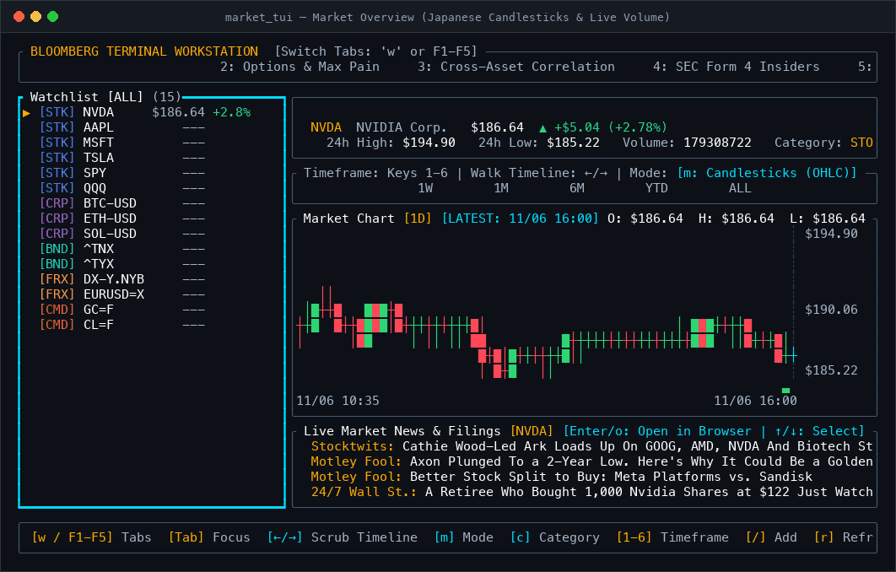
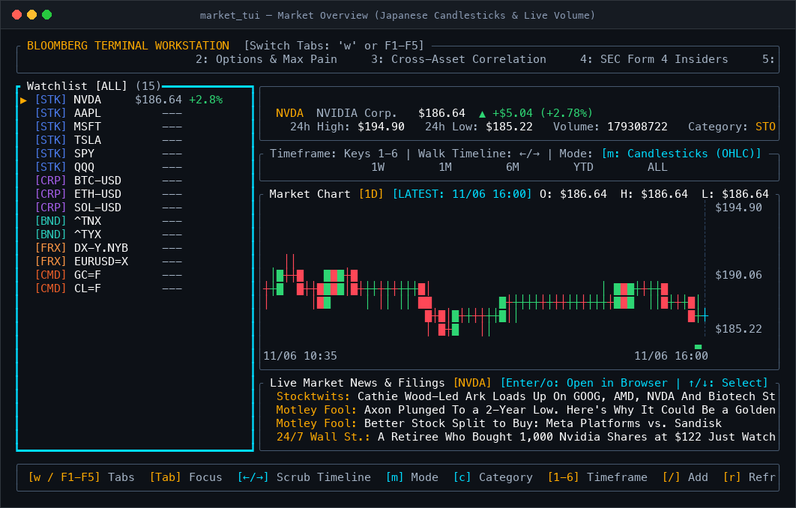
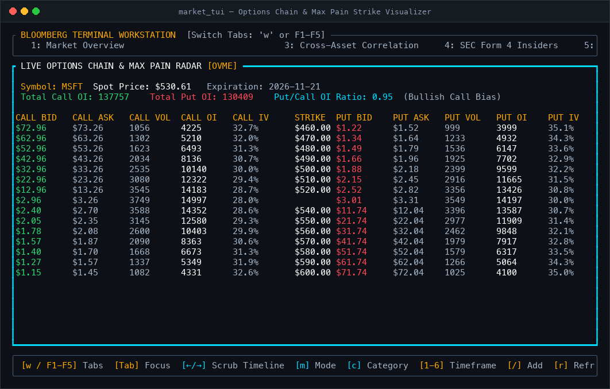
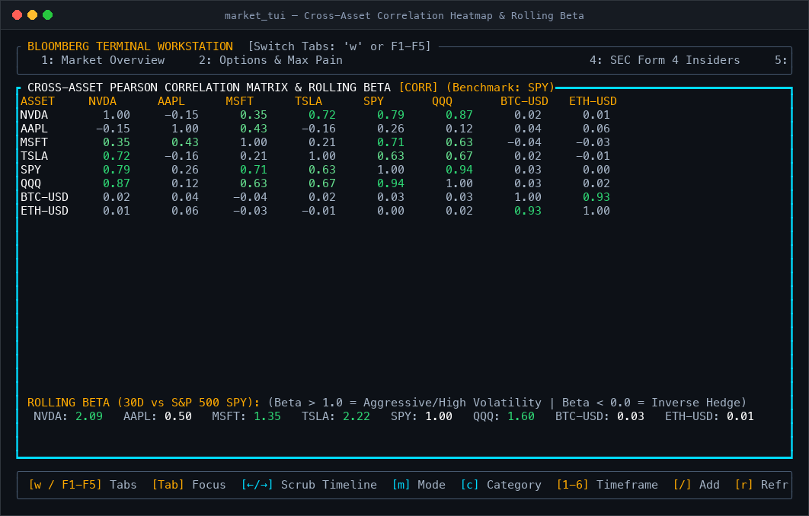
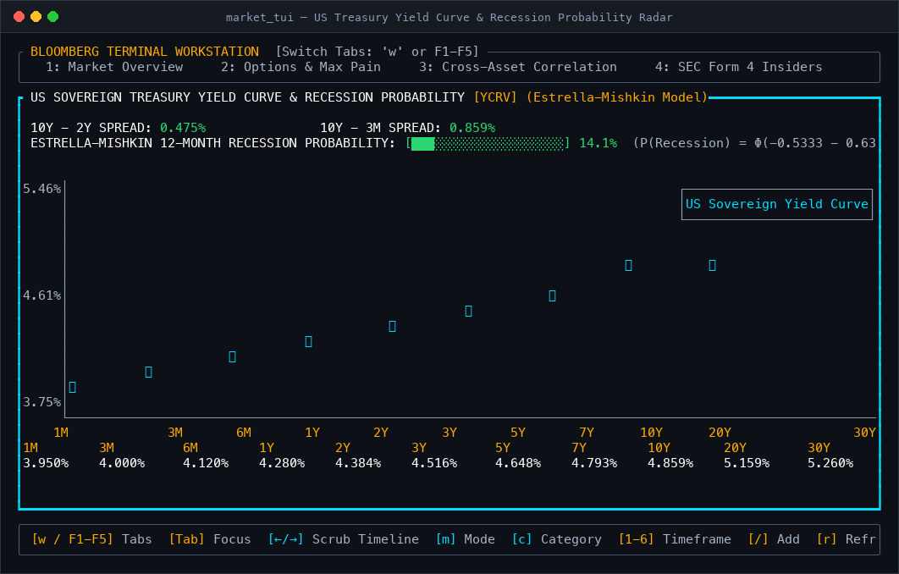

# 📈 Market TUI

> **The stock, crypto, and macro workstation that lives in your terminal.**  
> Think Bloomberg Terminal vibes, but lightweight, open-source, and written in blazingly fast Rust.

<p align="center">
  
</p>

---

## ✨ Why You'll Love It

Most financial dashboards are bloated browser tabs eating up 4 GB of RAM with sluggish charts and ad banners. 

**Market TUI** brings all your market data back into the terminal where it belongs:
- **Instant startup** with zero lag.
- **Japanese Candlesticks** with actual wicks (`│`), solid bodies (`█`), and live volume bars (` ▂▃▄▅▆▇█`).
- **Interactive Timeline Scrubber**: Walk through historical bars with `←` / `→` to inspect exact dates, OHLC prices, and volume.
- **Multi-Asset Coverage**: Stocks, Crypto, US Treasuries, Currencies, and Commodities in one view.
- **Direct News Feed**: Scroll live headlines and hit `Enter` to open articles directly in your default browser.
- **Institutional Workstations**: Options Max Pain, Cross-Asset Correlation Matrices, SEC Form 4 Insider Tracking, and US Yield Curve Recession Modeling.

---

## 🎛️ The 5 Workstations

Press **`w`** or keys **`F1` – `F5`** at any time to switch between workstations:

### 1. Market Overview (`F1`)
Your primary trading desk. Displays your active watchlist, full-screen price chart, volume histogram, high/low/volume stats, and real-time news headlines.
- Toggle between **Candlesticks** and **Continuous Solid Line** with `m`.
- Cycle timeframes (`1D`, `1W`, `1M`, `6M`, `YTD`, `ALL`) using keys `1`–`6`.
- Inspect any candle across the timeline using `←` and `→`.

<p align="center">
  
</p>

---

### 2. Options Chain & Max Pain Visualizer (`F2`)
See where options market makers are positioned and where the price is most likely to pin on expiration Friday.
- Dual-sided options chain (**Calls** on the left, **Puts** on the right).
- Strike-by-strike Bid/Ask, Last price, Volume, Implied Volatility (IV), and Open Interest (OI).
- Real-time **Put/Call OI Ratio** and **Max Pain Strike** calculation.

<p align="center">
  
</p>

---

### 3. Cross-Asset Correlation & Beta Matrix (`F3`)
Quantify relationships across your portfolio before market shocks hit.
- Full $N \times N$ **Pearson Correlation Matrix** color-coded from Emerald (`+1.00`, moving in lockstep) to Bright Coral (`-1.00`, inverse hedge).
- **30-Day Rolling Beta vs SPY** to identify aggressive movers ($\beta > 1.0$) vs low-volatility stabilizers.

<p align="center">
  
</p>

---

### 4. SEC Form 4 Smart Money Radar (`F4`)
Track what corporate insiders (CEOs, CFOs, Directors, and 10%+ owners) are doing with their own cash.
- Direct parsing of **SEC EDGAR Form 4 filings**.
- Filters out routine scheduled options exercises (`Rule 10b5-1`).
- Highlights open-market **Cluster Buys** (multiple executives buying simultaneously).

---

### 5. Treasury Yield Curve & Recession Radar (`F5`)
The ultimate macro health check. Tracks sovereign yield rates from 1-Month Bills to 30-Year Bonds.
- Real-time **$10Y - 2Y$** and **$10Y - 3M$** yield spread tracking.
- Instant **Inversion Alerts** when short-term yields exceed long-term yields.
- **Estrella-Mishkin 12-Month Recession Probability Model** calculated live via standard normal cumulative distribution.

<p align="center">
  
</p>

---

## ⌨️ Keyboard Shortcuts

| Key | Action |
|:---:|:---|
| **`Tab`** | Switch focus between **Watchlist**, **Chart**, and **News** |
| **`↑` / `↓`** | Select ticker in watchlist, or scroll through news headlines |
| **`←` / `→`** | Walk through historical candles on the chart timeline |
| **`w`** / **`F1`–`F5`** | Cycle or jump between the 5 Workstations |
| **`m`** | Toggle chart style (**Japanese Candlesticks** vs **Continuous Solid Line**) |
| **`1` – `6`** | Switch timeframe: `1D`, `1W`, `1M`, `6M`, `YTD`, `ALL` |
| **`c`** | Filter watchlist by asset category: `All` ➔ `Stocks` ➔ `Crypto` ➔ `Bonds` ➔ `Forex` ➔ `Commodities` |
| **`Enter`** / **`o`** | Open selected news headline in your default browser |
| **`r`** | Manually force refresh market data |
| **`q`** / **`Esc`** | Quit application |

---

## 🚀 Quickstart

### Prerequisites
You only need a modern Rust toolchain installed:
```bash
curl --proto '=https' --tlsv1.2 -sSf https://sh.rustup.rs | sh
```

### Build & Run
```bash
# Clone the repository
git clone https://github.com/Jdansak/market-tui.git
cd market-tui

# Run in release mode for maximum performance
cargo run --release
```

To install it system-wide so you can launch it with just `market_tui`:
```bash
cargo install --path .
```

---

## 🎨 Color Palette & Accessibility

Market TUI is designed with high-contrast, terminal-friendly colors that look great on any dark theme:
- **Electric Cyan (`#00DCFF`)**: Active pane borders and cursor focus.
- **Vivid Emerald (`#2ED573`)**: Gains, bullish wicks/bodies, and positive correlations.
- **Bright Coral (`#FF4757`)**: Losses, bearish wicks/bodies, and negative correlations / inversions.
- **Electric Amber (`#FFAA00`)**: Caution markers, Max Pain strike, and yield warnings.
- **Deep Slate (`#0D1117`)**: Clean dark background.

---

## 🛠️ Architecture

- **Engine**: [Ratatui](https://github.com/ratatui/ratatui) 0.29 + [Crossterm](https://github.com/crossterm-rs/crossterm) 0.28
- **Async Runtime**: [Tokio](https://tokio.rs) multi-threaded reactor
- **Data Engine**: Resilient async HTTP client with intelligent fallback mock generators so the terminal works smoothly even when offline or behind restrictive firewalls.
- **Crash Safety**: Clean custom panic hook that restores your terminal cursor and raw mode so your terminal shell is never left in a corrupted state.

---

## 📄 License

MIT License. Feel free to fork, customize, and build your own trading tools!
